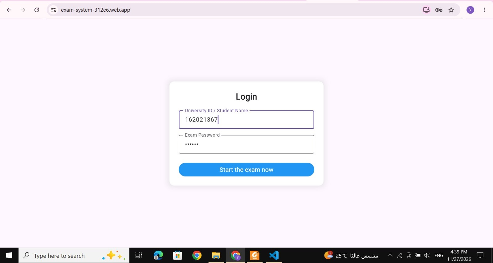
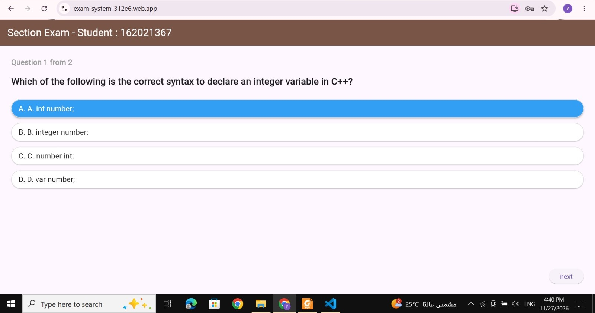
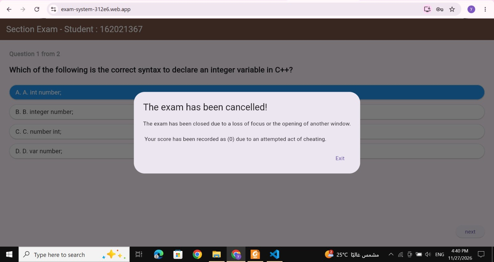
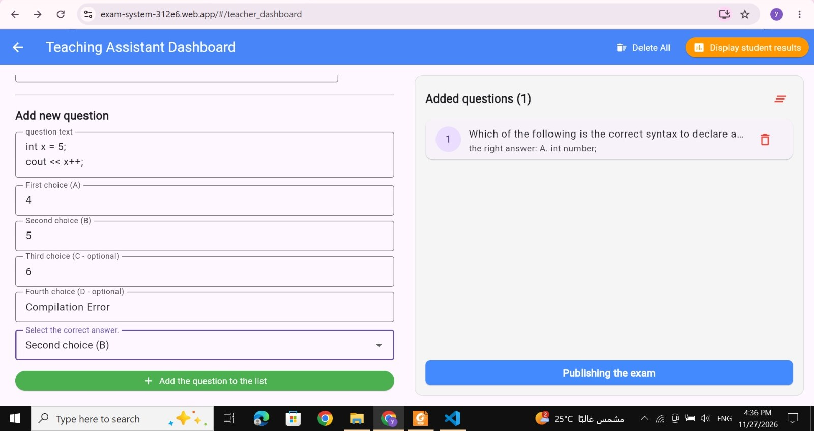
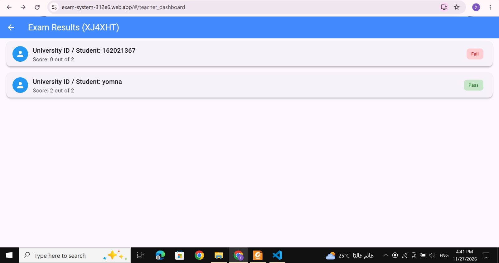

# 📝 Safe Exam System

A Flutter-based online examination system designed to help teaching assistants create and manage exams while providing students with a simple interface to take exams and submit their answers.

The system uses Firebase Firestore to store exam questions, student submissions, and examination results.

## ✨ Features

### 👨‍🏫 Teaching Assistant Dashboard
- Create and publish exams.
- Generate random passwords for exam access.
- Add multiple-choice questions (MCQs).
- Define four answer options and select the correct answer.
- View students' exam results.
- Display student scores and pass/fail status.

### 🎓 Student Interface
- Enter a university ID or student name.
- Access exams using an exam password.
- Prevent duplicate exam attempts.
- Navigate between questions.
- Select and submit answers.
- View the final exam score.

### 🔒 Basic Anti-Cheating Measures
- Detect browser tab visibility changes.
- Detect browser window focus loss.
- Disable the browser's right-click context menu.
- Automatically submit the exam when a monitored event is detected.

> Note: These are basic client-side browser monitoring measures and should not be considered a comprehensive anti-cheating or proctoring solution.

## 🛠️ Tech Stack

| Technology | Purpose |
|---|---|
| Flutter | User Interface |
| Dart | Programming Language |
| Firebase Core | Firebase Initialization |
| Cloud Firestore | Database |
| Material Design | UI Components |


## 📸 Application Screenshots

### Student Interface

| Student Login | Exam Page |
|:---:|:---:|
|  |  |

| Anti-Cheating Warning |
|:---:|
|  |

### Teaching Assistant Dashboard

| Teacher Dashboard | Exam Result |
|:---:|:---:|
|  |  |


## 🔄 How It Works

1. The teaching assistant creates an exam and adds questions.
2. The system generates a unique access password.
3. The exam is published and stored in Cloud Firestore.
4. Students enter their university ID and exam password.
5. The system checks exam availability and previous submissions.
6. Students answer the questions and submit the exam.
7. The system calculates the score and stores the result.
8. The teaching assistant can access the recorded results through the dashboard.


## 🚀 Getting Started

### Prerequisites
- Flutter SDK
- Dart SDK
- Firebase Project
- Firebase Firestore enabled
- Google Chrome

### Installation

1. Clone the repository:

```bash
git clone https://github.com/Yomna254/safe-exam-system.git
```

2. Navigate to the project directory:

```bash
cd safe-exam-system
```

3. Install dependencies:

```bash
flutter pub get
```

4. Configure your Firebase project and Firestore security rules.

5. Run the application in Chrome:

```bash
flutter run -d chrome
```

### Build for Web

```bash
flutter build web
```

## 🔐 Security Considerations

- Enforce role-based access control through trusted server-side authorization.
- Configure Firestore Security Rules to protect exam data and student results.
- Validate exam submissions and scores on a trusted backend.

## 👩‍💻 My Role

Designed and developed the application using Flutter and Dart, including the student exam interface, teaching assistant dashboard, exam management workflows, and Firebase Firestore integration.

---

**Developed by Yomna Mohamed**

[GitHub](https://github.com/Yomna254)
